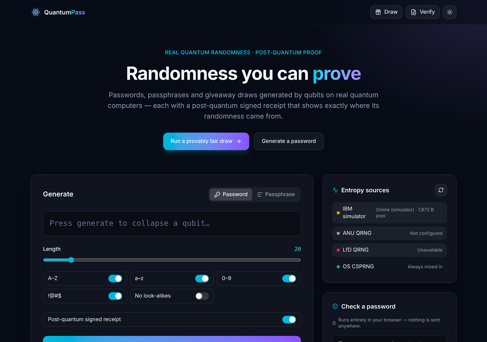
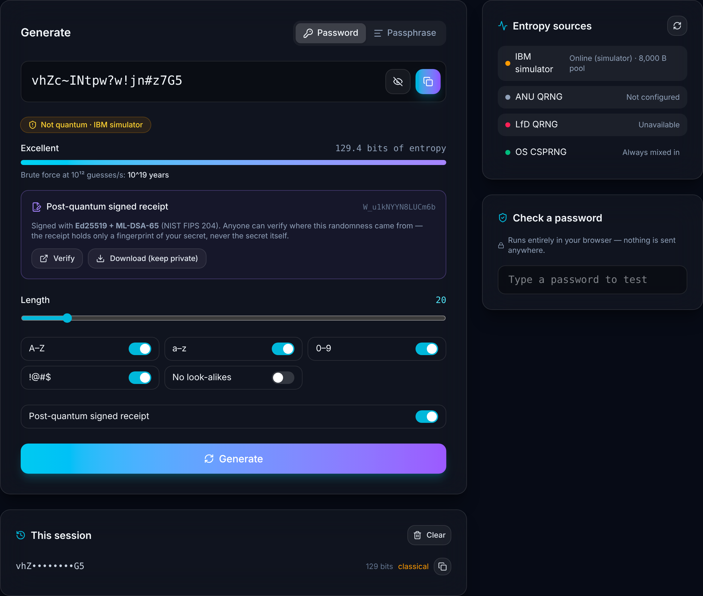
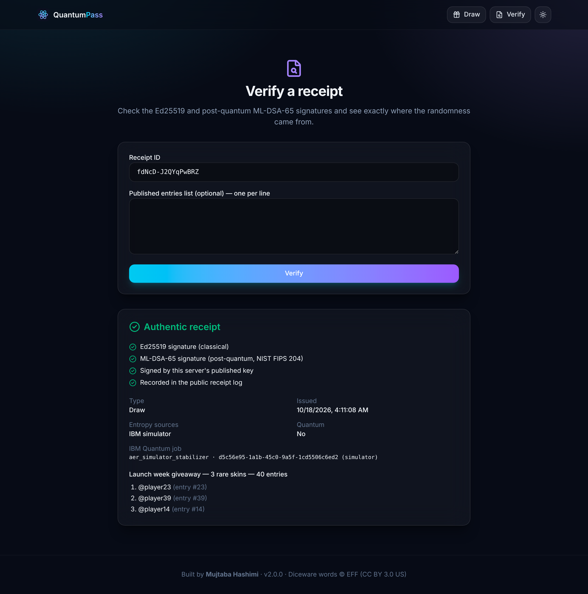
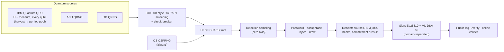
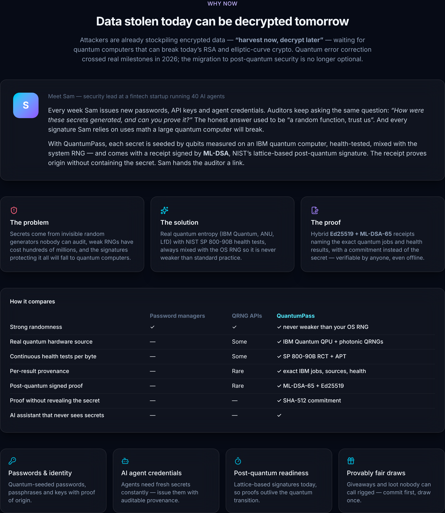
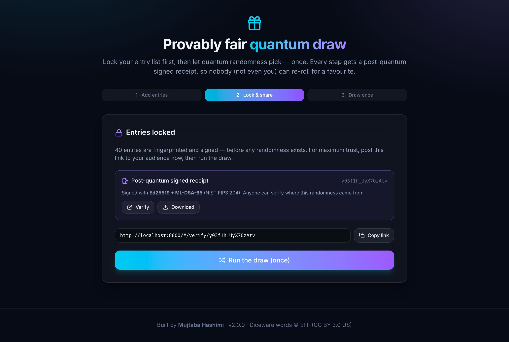
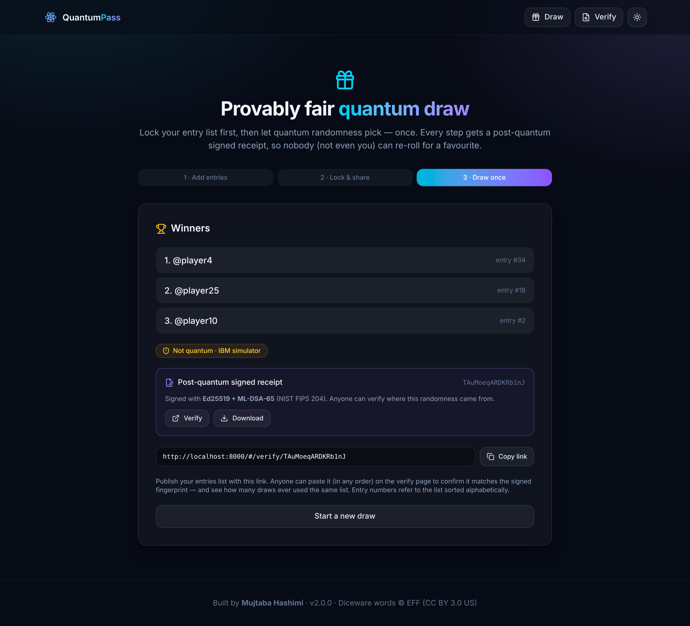

<div align="center">


# QuantumPass

### Secrets built for the quantum era.

Passwords, passphrases, keys and fair draws seeded by qubits on **real IBM quantum computers**, health-screened, mixed with your system's secure RNG, and sealed with a **lattice-based post-quantum signature** that records what this server asserts about where the entropy came from.

[](https://github.com/ahmadhashimi/quantum-password-generator/actions/workflows/ci.yml)


<sub>Generate → signed receipt → public verification → commit-then-run draw. Recorded in simulator mode (see the note below).</sub>

</div>

---

## Why now

For twenty years quantum computing was "five years away". In 2026 error-corrected logical qubits stopped being a physics problem and became an engineering one. You will never own a quantum computer — you'll rent one in the cloud, which is exactly what this project does.

The urgent part isn't the future; it's **"harvest now, decrypt later"**: attackers are already stockpiling encrypted data to unlock once RSA and elliptic-curve crypto fall. Two things follow for anyone who issues secrets:

1. **Provenance matters.** "We used a random function, trust us" is no longer an acceptable answer to an auditor.
2. **Signatures must outlive the transition.** Anything you sign today with Ed25519 or RSA alone has an expiry date.

QuantumPass is a small, production-hardened answer to both.

## The story

> **Meet Sam** — security lead at a fintech startup running 40 AI agents.
>
> Every week Sam issues passwords, API keys and agent credentials. Auditors keep asking the same question: *"How were these generated, and can you prove it?"* And every signature Sam relies on uses math a large quantum computer will break.
>
> With QuantumPass, each secret is seeded by qubits measured on an IBM quantum computer, health-tested, mixed with the system RNG — and comes with a receipt signed by **ML-DSA**, NIST's lattice-based post-quantum standard. The receipt authenticates the server's claims **without containing the secret**; it does not independently authenticate hardware origin. Sam hands the auditor a link.



## Problem → solution → what's new

| | |
|---|---|
| **Problem** | Secrets come from invisible random generators nobody can audit. Weak RNGs have cost hundreds of millions (Wintermute ≈ $160M, "Milk Sad"). The signatures protecting everything will fall to quantum computers. |
| **Solution** | Real quantum entropy from **IBM Quantum QPUs**, the **ANU** vacuum-fluctuation QRNG and the **LfD** photonic QRNG — screened with SP 800-90B-style RCT/APT tests (not NIST-certified) and always mixed with the OS CSPRNG, which under the stated cryptographic assumptions preserves the OS CSPRNG baseline. |
| **What's new** | Every result can carry a **hybrid Ed25519 + ML-DSA-65 signed receipt** naming the exact IBM jobs, the sources, the health result and a **commitment** to the secret instead of the secret. Anyone can verify it — on our page or **offline** with a 50-line script. Draws are **commit-then-run**: entries are locked and signed before any randomness exists. |

<table>
<tr>
<td width="60%"></td>
<td width="40%"></td>
</tr>
<tr>
<td align="center"><sub><b>Generator</b> — provenance badge, exact entropy, signed receipt</sub></td>
<td align="center"><sub><b>Verify</b> — both signatures, key status, IBM job, and re-roll detection (this list was drawn twice, so it is flagged in red)</sub></td>
</tr>
</table>

### Honest about what is and isn't new

- Signing quantum randomness with a post-quantum signature has been done in research (e.g. USTC's DI-QRNG beacon), and hybrid Ed25519 + ML-DSA is an IETF composite design. **We do not claim to have invented post-quantum signing.**
- What we have not found elsewhere is the **combination in a product**: per-result receipts that bind real cloud-QPU job IDs, SP 800-90B-style health screening results and a secret commitment under a domain-separated hybrid PQ signature, with a public log, a re-roll-visible commit-then-run draw, and an offline verifier.
- The receipt proves what **this server** committed to and signed. It does **not** prove quantum origin against a dishonest operator (IBM doesn't sign job results). It is **not** device-independent or "certified" randomness, and it is **not** a "quantum signature" (those require quantum channels and don't exist as products). See [docs/SECURITY.md](docs/SECURITY.md) for the full limits.

## Who it's for

| Persona | Pain | What they get |
|---|---|---|
| 🔐 **Security / platform lead** issuing passwords, keys, agent credentials | "Prove how this secret was generated" | Quantum-seeded secrets with a verifiable, PQ-signed origin receipt |
| 🤖 **AI-agent operators** | Agents mint fresh secrets constantly, with no audit trail | API with provenance per secret; an assistant that never sees the values |
| 🧰 **Security / dev-tool founders** | Product looks like everyone else's | White-label generation with real evidence behind the "quantum" word |
| 🎮 **Game / web3 studios, communities, brands** | "The draw was rigged!" | Commit-then-run draws with a public receipt nobody can fake |
| 🎓 **Lecturers / researchers** | Students can't easily inspect real QPU randomness | Live quantum entropy, health-test telemetry and receipts |

**Industries where this lands first:** fintech and crypto infrastructure (key ceremonies, audit trails), AI platforms (agent credential issuance), security tooling, gaming/esports/creator economy (fair draws), education. **Not yet:** regulated gambling, banking cores and government — they require certifications (FIPS 140-3/ESV, GLI-19, FedRAMP) this project does not have.

### Compared with the alternatives

| | Password managers (1Password, Bitwarden…) | random.org signed API / draws | Chainlink VRF | QRNG APIs (ANU, Cisco, Quantinuum Origin) | **QuantumPass** |
|---|---|---|---|---|---|
| Strong randomness | ✓ | ✓ | ✓ | ✓ | ✓ mixed with the OS CSPRNG |
| Real quantum hardware source | — | — (atmospheric noise) | — | ✓ | ✓ IBM QPU + ANU + LfD, labelled per result |
| Continuous health tests exposed | — | — | — | some | ✓ 800-90B-style tests (not certified), in the receipt |
| Per-result provenance (which device, which job) | — | serial numbers | on-chain proof | rarely | ✓ exact IBM job IDs |
| Post-quantum signed proof | — | — (classical) | — (ECC) | — | ✓ ML-DSA-65 + Ed25519 |
| Proof without revealing the secret | n/a | — | n/a | — | ✓ commitment + private salt |
| Fair draws anyone can audit | — | ✓ (classical, trust the server) | ✓ (per-request gas) | — | ✓ commit-then-run, re-rolls visible, free |
| AI assistant that never sees secrets | — | — | — | — | ✓ |
| Price | $3–8 / user / mo | ~$30 / mo tier | per request + gas | per request / enterprise | free tier; Pro ≈ $5 / mo (planned) |

Market, pricing, costs and a 90-day plan: **[docs/BUSINESS_PLAN.md](docs/BUSINESS_PLAN.md)** (with an independent reviewer's notes appended). Deployment in 30 minutes: **[docs/DEPLOY.md](docs/DEPLOY.md)**.

---

## How it works





### Receipt format

```json
{
  "payload": {
    "version": "qpg-receipt/1",
    "receipt_id": "g1K6_BB_kXw85bNz",
    "kind": "password",
    "key_id": "ae553ddae018275e",
    "provenance": {
      "sources": ["ibm_quantum", "lfd"], "quantum": true, "quantum_bytes": 128,
      "ibm_jobs": [{ "backend": "ibm_brisbane", "job_id": "d0…", "mode": "hardware" }],
      "health": { "sp800_90b_style": "pass" }
    },
    "entropy_bits": 129.4,
    "commitment": "sha512(salt ‖ password) — the salt goes only to you",
    "result": null
  },
  "signatures": { "ed25519": "…", "ml-dsa-65": "…" }
}
```

A receipt is valid only if **both** signatures verify over `SIGNING_DOMAIN ‖ canonical_json(payload)`, so neither signature can be stripped and reused alone, and the receipt stays trustworthy unless both schemes are broken.

### Verify anything offline

```bash
curl -s https://<host>/.well-known/quantumpass-keys.json > keys.json
python -m scripts.verify_receipt receipt.json keys.json --entries entries.json
# Ed25519: ok   ML-DSA-65: ok
# Entries list matches: True
# VALID
```

Flip a single field (say `"quantum": false` → `true`) and the result is **INVALID**.

### Provably fair draws, in two steps

<table>
<tr>
<td width="50%"></td>
<td width="50%"></td>
</tr>
<tr>
<td align="center"><sub><b>1. Lock</b> — entries are de-duplicated, sorted, fingerprinted and signed <i>before</i> randomness exists</sub></td>
<td align="center"><sub><b>2. Run once</b> — atomic; the result receipt references the commit</sub></td>
</tr>
</table>

Verification shows how many draws **anyone** ever ran over the same entry list, so "re-roll until my friend wins" is visible even across accounts or shuffled lists.

---

## Security

Built security-first and then **adversarially audited** (6 specialist reviewers, every finding challenged by two independent verifiers, 85 agents). Every critical and high finding is fixed; details and the residual list are in **[docs/SECURITY.md](docs/SECURITY.md)**.

| Area | What's in place |
|---|---|
| Secrets | Never stored, logged, cached or sent to the AI; receipts hold commitments only; `no-store` on every API response |
| Crypto | Hybrid Ed25519 + ML-DSA-65 (FIPS 204) with domain separation; HKDF/HMAC-SHA512; keyring with rotation and revocation; keys in 0600 files or secret env |
| Entropy supply | 800-90B-style RCT + APT screening per byte (not certified); batched, throttled upstream calls; hour-long back-off on quota/auth refusals; IBM pool reserved for signed-in users with daily quotas |
| Abuse | Global per-IP limit before any work; body-size limit; per-route and per-user limits; IPv6 /64 buckets; only the proxy's fixed address is trusted for client IPs |
| Draw integrity | Commit-then-run, once-only execution, canonical fingerprints, public sibling counts, 50 draws/user/day, retention for anonymous receipts |
| AI cost & safety | Atomic admit-and-reserve, one stream per user, settlement shielded from disconnects, USD caps per user/day/month, token/tool/secret caps — see [docs/AI_SAFETY.md](docs/AI_SAFETY.md) |
| Auth | Clerk session JWTs verified server-side; admin requires a second factor verified within the hour; deleted users stay deleted |
| Web | Strict CSP (production rejects wildcard Clerk hosts), `frame-ancestors 'none'`, Host allowlist (blocks DNS rebinding), error boundary, organiser text labelled as unverified |
| Supply chain | Hash-pinned lock files (`--require-hashes --no-deps`), images pinned by digest, Actions pinned by SHA, pip-audit / npm audit / bandit, Dependabot |
| Container | Non-root, read-only filesystem, all capabilities dropped, production defaults forced by compose |

---

## Quick start

```bash
# Backend
cd backend
python -m venv .venv && source .venv/bin/activate
pip install --require-hashes --no-deps -r requirements.lock -r requirements-ibm.lock
pip install -r requirements-dev.txt qiskit-aer
cp .env.example .env                 # dev defaults; every key is optional locally
uvicorn app.main:app --reload        # http://localhost:8000/api/docs

# Frontend (second terminal)
cd frontend && npm install && npm run dev     # http://localhost:5173
```

With no keys at all it runs on LfD (keyless) + the OS RNG and labels results accordingly. In dev mode without Clerk you are signed in as a local admin.

### Connect IBM Quantum — simulator first, then hardware

```bash
IBM_MODE=simulator python -m scripts.ibm_harvest                      # free dry run; results say "not quantum"
IBM_MODE=hardware IBM_QUANTUM_TOKEN=... IBM_QUANTUM_INSTANCE=crn:v1:... \
  POOL_PATH=./entropy_pool.bin python -m scripts.ibm_harvest           # real QPU (Open Plan: us-east CRN)
```

One job (127 qubits × 2,048 shots, job mode) uses a few QPU-seconds and yields ~8 KB of conditioned entropy ≈ 127 seeds. `IBM_MAX_JOBS_PER_DAY` (default 2) keeps you inside the free 10 QPU-minutes per 28 days.

### Clerk (sign-in, MFA, passkeys)

1. Set `VITE_CLERK_PUBLISHABLE_KEY` (frontend) and `CLERK_SECRET_KEY` (backend); in production also `CLERK_HOSTS=["https://clerk.<your-domain>"]`.
2. Clerk dashboard → **Passkeys: on**, **MFA: authenticator + backup codes**, **Attack protection: on**.
3. **Sessions → Customize session token:** `{"email": "{{user.primary_email_address}}", "name": "{{user.full_name}}", "metadata": "{{user.public_metadata}}"}`
4. Give yourself `{"role": "admin"}` in public metadata. Admin routes also require a second factor verified in the last hour.
5. Optional webhook `https://<host>/api/v2/webhooks/clerk` + `CLERK_WEBHOOK_SECRET`.

### Deploy

```bash
cp backend/.env.example backend/.env          # keys only; compose forces production settings
DOMAIN=quantumpass.example.com VITE_CLERK_PUBLISHABLE_KEY=pk_live_... docker compose up -d --build
```

Caddy (auto-TLS, HTTP/3, 1 MB body limit, unbuffered SSE) fronts a single app instance on a private network with fixed addresses. Rate limits, the entropy pool and chat sessions live in process memory — move them to Redis/Postgres before scaling out.

---

## API

| Endpoint | Description |
|---|---|
| `GET /api/v2/password?length=20&…&receipt=true` | Password + entropy bits + provenance (+ signed receipt + private salt) |
| `GET /api/v2/passphrase?words=6&…&receipt=true` | EFF diceware passphrase |
| `GET /api/v2/random?bytes=32&receipt=true` | Random bytes (hex) |
| `POST /api/v2/draws` → `POST /api/v2/draws/{id}/run` | Commit entries (signed), then run once |
| `POST /api/v2/receipts/verify` | Verify signatures, key status, commitment, entries, re-roll counts |
| `GET /api/v2/receipts/{id}` · `GET /.well-known/quantumpass-keys.json` | Public log · public keys (active, retired, revoked) |
| `GET /api/v2/entropy/status` | Coarse source health (admins see full detail in `/admin/stats`) |
| `POST /api/v2/assistant/chat` | AI assistant, server-sent events (sign-in required) |

## Testing

```bash
cd backend && pytest        # 108 tests: entropy, health tests, IBM simulator, receipts & tamper cases, draws, auth, guardrails
pytest -m live              # real ANU/LfD calls (network / ANU_API_KEY)
python -m scripts.entropy_audit
cd frontend && npm test     # 7 tests
```

> **About the screenshots and demo:** they were captured in a sandbox with no network path to IBM, ANU or LfD, running IBM in **simulator mode**. That is why every badge honestly reads *"Not quantum · IBM simulator"* — the product refuses to call anything quantum unless a real quantum source contributed. On hardware the same badge reads *"Quantum · IBM Quantum + LfD QRNG"*.

## Roadmap

- [x] Real quantum entropy (IBM, ANU, LfD) with health tests and honest labels
- [x] Hybrid post-quantum receipts, public log, offline verifier, key rotation
- [x] Commit-then-run provably fair draws
- [x] Adversarial security audit; all critical/high findings fixed
- [ ] Signing keys in an HSM/KMS; append-only transparency log (Merkle) for receipts
- [ ] Public-beacon-anchored evidence receipts (v3 design, documented privately pending IP review)
- [ ] Stripe plans (Free / Pro / Team / API) with automatic limits; developer API keys
- [ ] Discord/Twitch draw bot; embeddable "Verified" badge

---

## Q&A

**Can anyone crack these passwords?**
Not by guessing. A 20-character password here has ≈ 129 bits of entropy; at 10¹² guesses/s that is ~10¹⁹ years. A quantum computer running Grover's algorithm roughly halves the exponent — still far out of reach, and you can pick 256-bit secrets (≈ 40 characters or ≈ 20 words) for margin. Real breaches come from phishing, reuse, leaks and malware, which no generator fixes — use passkeys and MFA (both supported via Clerk).

**Is it really quantum, or fake?**
It is built on real quantum sources: IBM QPUs (job IDs recorded per receipt), ANU and LfD. In this sandbox we could only run the IBM *simulator*, and the app says so on every result. Connect your IBM key and the badge changes to "Quantum" with the real backend and job ID.

**Is it "unhackable"?**
No system is, and we don't say it. What we claim: strong randomness mixed with the OS CSPRNG under documented assumptions, server-signed provenance you can inspect, post-quantum signed receipts, and an audited, hardened service. The limits are written down in [docs/SECURITY.md](docs/SECURITY.md).

**Is this a "quantum signature"? Lattice crypto?**
It is a **post-quantum** signature: ML-DSA-65 is lattice-based (Module-Lattice DSA, FIPS 204), combined with Ed25519. True quantum signatures need quantum channels and don't exist as products.

**Can the operator rig a draw?**
Not silently. Entries are committed and signed before randomness exists, a draw runs exactly once, and the verify page shows how many draws anyone ran over that entry list (shuffling doesn't hide it). A fully operator-independent draw needs public-beacon anchoring — that is the v3 design.

**Can you see my password? Can the AI?**
No. Passwords are generated per request and never stored or logged; the receipt holds only a salted SHA-512 fingerprint; the AI assistant receives metadata and a `secret_id`, never the value.

**Why mix quantum bytes with the OS RNG at all?**
So a tampered, biased or offline quantum source can never make output *worse* than standard practice. Quantum entropy can only add; it can't subtract.

**What if IBM, ANU or LfD is down?**
Generation still works on the remaining sources or the OS CSPRNG, and the result is labelled accordingly. Nothing fails open into a false "Quantum" claim.

**Is this patented / unique?**
The pieces are known; the combination as a product appears to be unoccupied. Nothing is patented. Note that this public repo already discloses the receipt design; any patentable next step must be filed *before* it is published.

**What does it cost to run?**
On the IBM Open Plan the quantum entropy is free (10 QPU-min / 28 days ≈ thousands of seeds). The AI assistant is the main variable cost; hard USD caps bound it, and switching the assistant model to Haiku cuts assistant cost ~40×.

**Why a single instance?**
Simplicity and correctness for a small service: rate limits, the entropy pool and chat sessions are in memory. The README and compose file say exactly what to externalise before scaling.

---

<div align="center">

Built by **Mujtaba Hashimi** · Diceware wordlist © EFF (CC BY 3.0 US), lightly filtered · Security policy: [`/.well-known/security.txt`](frontend/public/.well-known/security.txt)

</div>
