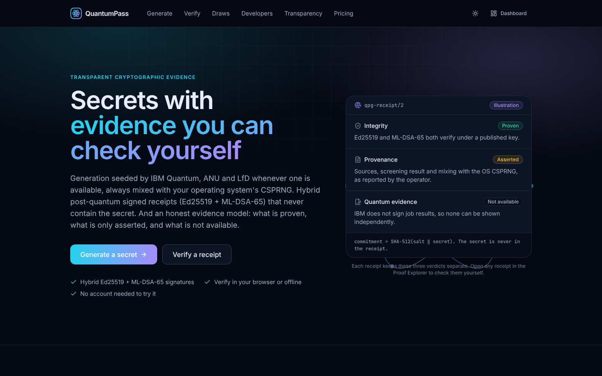
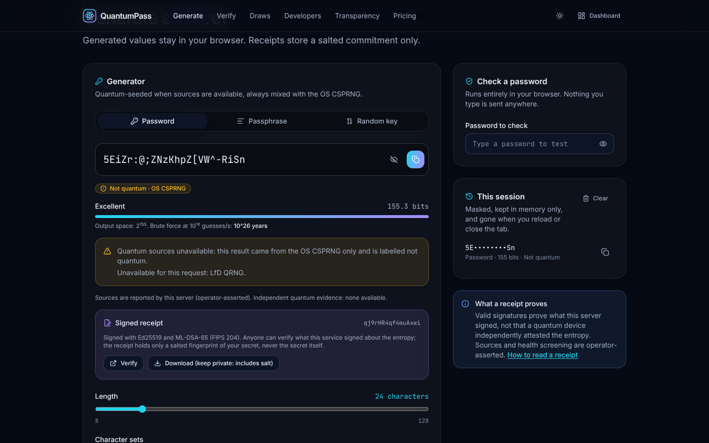
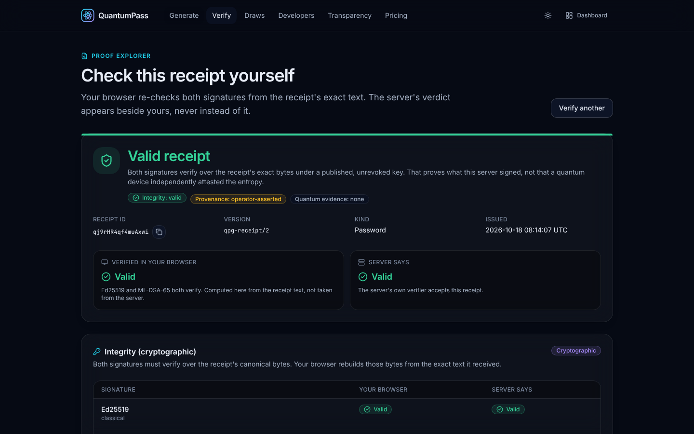
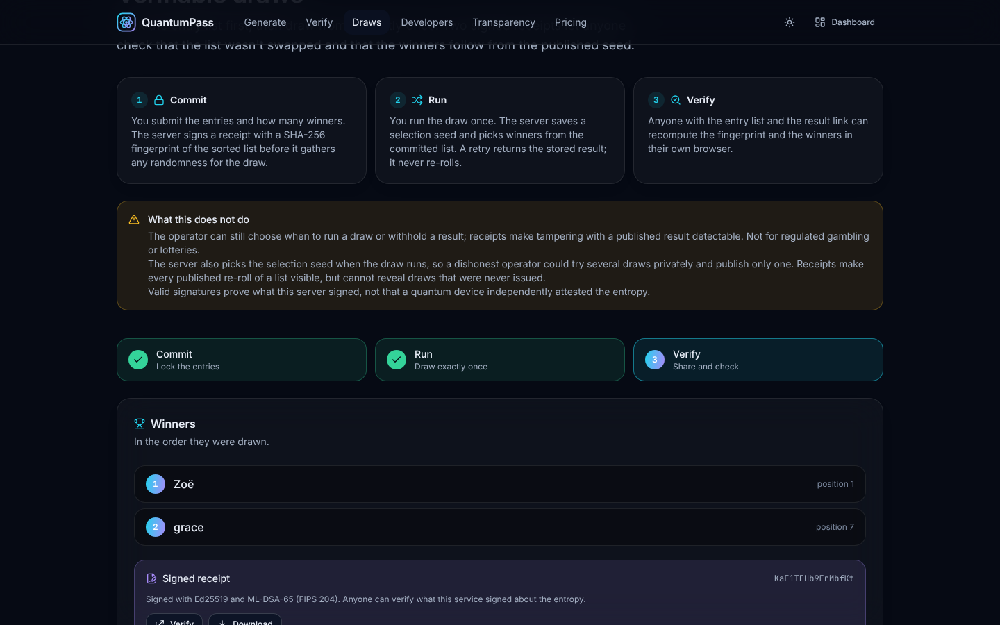
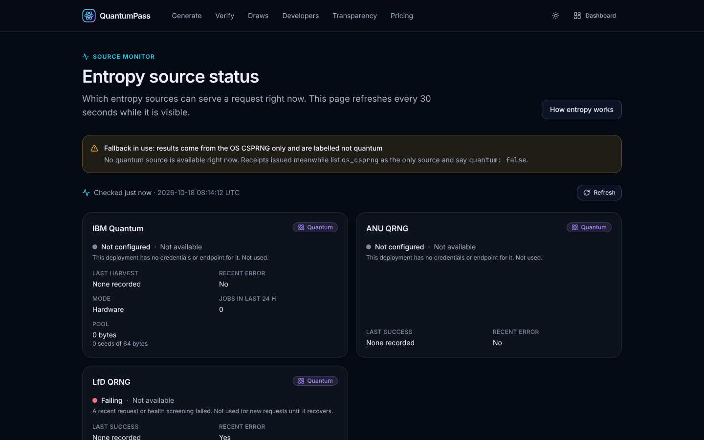
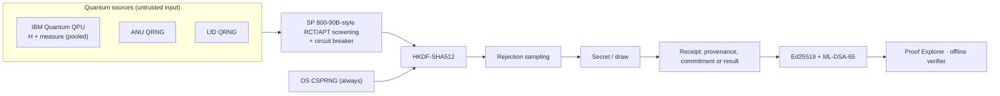

<div align="center">


# QuantumPass

### Secrets with evidence you can check yourself.

Passwords, keys and fair draws seeded by quantum entropy (IBM Quantum, ANU, LfD), always mixed with your system's
secure RNG. Each result can carry a receipt signed with **Ed25519 + ML-DSA-65** (post-quantum, FIPS 204) that holds a
commitment to the secret, never the secret. Every receipt says exactly what it proves, what is only asserted, and
what isn't available.

[](https://github.com/ahmadhashimi/quantum-password-generator/actions/workflows/ci.yml)




</div>

---

## Why

Auditors increasingly ask *"how was this credential generated, and can you prove it?"*, and "harvest now, decrypt
later" means signatures made today should survive the move to post-quantum cryptography. QuantumPass answers both
without pretending to more than it can show:

| What a receipt gives you | Class | How you check it |
|---|---|---|
| The server signed exactly this payload, with both a classical and a post-quantum signature | **Proven** (integrity) | Anyone, offline, with the published keys |
| Which sources contributed, which IBM jobs, health-screening status | **Asserted** (by the operator) | Visible and signed, but not independently provable |
| Independent proof that the bytes came from quantum hardware | **Not available** | IBM doesn't sign job results; no one can offer this today |

The site keeps these three apart everywhere. Simulator output says "not quantum". A source that is down is never
shown as contributing. Nothing is described as certified.

## Features

- **Generate**: passwords, passphrases and random keys, from quantum entropy mixed with the OS CSPRNG through
  HKDF-SHA512. Secrets live only in your browser's memory; the copied value is cleared from the clipboard after 30 s.
- **Signed receipts**: hybrid Ed25519 + ML-DSA-65, domain-separated, strict versioned schema (`qpg-receipt/2`).
  They store `SHA-512(salt ‖ secret)` and the salt is returned only to you.
- **Proof Explorer** (`/verify/{id}`): both signatures are verified **in your browser** and compared with the
  server's verdict. It covers key status, a local commitment check, provenance with IBM hardware vs simulator,
  health-test limits, log status, draw recomputation, JSON evidence export and offline instructions.
- **Fair draws** (`/draws`): commit-then-run, executed at most once, with idempotency keys and crash recovery that
  never re-runs with fresh randomness. Winners can be recomputed by anyone from the published seed (`qpg-select/1`).
- **Source Monitor** (`/status`): live provider state with timestamps and clear fallback labels.
- **Accounts**: Clerk sign-in, dashboard with receipt history and usage quotas. **Admin**: stats, AI spend, the
  hash-chained audit log with chain verification, and recovery of interrupted draws.
- **Evidence API** (`/developers`): a documented, versioned contract with two independent reference verifiers
  (Python and TypeScript) checked against shared test vectors.
- **Security assistant**: Claude (Sonnet 5.5) helps choose and generate secrets but never sees the values.

<table>
<tr>
<td width="50%"></td>
<td width="50%"></td>
</tr>
<tr>
<td align="center"><sub><b>Generate</b>: provenance, entropy, signed receipt</sub></td>
<td align="center"><sub><b>Proof Explorer</b>: verified in your browser, three verdicts kept separate</sub></td>
</tr>
<tr>
<td width="50%"></td>
<td width="50%"></td>
</tr>
<tr>
<td align="center"><sub><b>Draws</b>: entries locked and signed before any randomness exists</sub></td>
<td align="center"><sub><b>Status</b>: timestamped sources and fallback labels</sub></td>
</tr>
</table>

## Architecture

```
Internet ─► Caddy (TLS, routing) ─┬─► web  (Next.js 16: pages, CSP nonce, in-browser verification)
                                  └─► api  (FastAPI: entropy, generation, receipts, draws, audit log)
                                            └─► PostgreSQL 16 (internal network)
```

`/api/v2/*`, `/quantum-*` and `/.well-known/quantumpass-keys.json` go straight to the API, so generated secrets never
pass through the website's server. Details: [docs/ARCHITECTURE.md](docs/ARCHITECTURE.md).



## Verify anything yourself

```bash
pip install cryptography
curl -s https://<host>/.well-known/quantumpass-keys.json > keys.json
python backend/scripts/verify_receipt.py receipt.json keys.json --value '<secret>' --salt '<salt>'
# ok    structure
# ok    key published  (9e7b41c6ec83bcaa)
# ok    key not revoked  (active)
# ok    Ed25519 signature
# ok    ML-DSA-65 signature
# ok    commitment opens to your value
# info  provenance, operator-asserted: sources=lfd quantum=True ibm_jobs=None
# info  quantum evidence: none: no independently authenticated proof of quantum origin is available
# VALID
```

The script imports nothing from this project. The algorithm is specified in
[docs/EVIDENCE_API.md](docs/EVIDENCE_API.md), and the browser verifier in `web/lib/verify` implements it
independently. Both pass the same cross-language vectors.

## Quick start

```bash
# API: http://localhost:8000
cd backend && python -m venv .venv && . .venv/bin/activate
pip install --require-hashes --no-deps -r requirements.lock -r requirements-ibm.lock
pip install -r requirements-dev.txt qiskit-aer
cp .env.example .env && uvicorn app.main:app --reload

# Website: http://localhost:3000
cd web && npm ci && cp .env.example .env.local && npm run dev
```

With no keys it runs on keyless sources plus the OS RNG and labels results accordingly. Without Clerk you're
signed in as a local admin. More in [docs/DEVELOPMENT.md](docs/DEVELOPMENT.md).

**Deploy** (Caddy + web + api + PostgreSQL): [docs/DEPLOY.md](docs/DEPLOY.md). **Operate** (backups, restore
drill, rollback, key compromise): [docs/RUNBOOK.md](docs/RUNBOOK.md).

### IBM Quantum on the free plan

One harvest job (127 qubits × 2,048 shots) takes a few QPU-seconds and yields 8,128 conditioned bytes, about 127
seeds. The Open Plan's 10 QPU-minutes per 28 days easily covers the default cap of 2 jobs a day, which is enforced
across restarts. When the pool runs dry, results fall back to ANU or LfD, then to the OS CSPRNG, and are labelled as
such. Full numbers: [docs/ENTROPY.md](docs/ENTROPY.md#ibm-capacity-the-10-minute-question).

## Security

| Area | In place |
|---|---|
| Secrets | Never stored, logged or sent to the AI; receipts hold commitments only; API responses `no-store`; a test scans logs and every table |
| Web | Per-request nonce CSP (`strict-dynamic`), `no-store` and no prefetch on sensitive pages, HSTS, `frame-ancestors 'none'`; secrets never in URLs, SSR HTML or RSC payloads |
| Receipts | Hybrid signatures, strict schema per version and kind, key labelling and revocation checks, lossless canonical JSON |
| Draws | Transactional commit, idempotency keys, at-most-once execution, crash recovery to `needs_investigation`, exact daily quota |
| Audit and logs | Hash-chained append-only audit log (database trigger), JSON logs with request IDs and redaction, route templates instead of URLs |
| Keys | Encrypted backup and restore, rotation and revocation CLI, emergency procedure |
| Data | PostgreSQL with Alembic migrations; backups with a tested restore drill |
| Supply chain | Hash-pinned Python locks, exact npm pins, images pinned by digest, Actions pinned by SHA, pip-audit, npm audit, bandit, Dependabot |
| Containers | Separate non-root images, read-only filesystems, dropped capabilities, only Caddy exposed, Postgres on an internal network |

Threat model, review results and the limits we state plainly: [docs/SECURITY.md](docs/SECURITY.md). Entropy
assumptions: [docs/ENTROPY.md](docs/ENTROPY.md).

## Testing

```bash
cd backend && ruff check . && mypy --strict app && pytest   # also on PostgreSQL: QPG_TEST_DATABASE_URL=...
cd web && npm run typecheck && npm run lint && npm test && npm run build && npm run test:e2e
```

## Q&A

**Is it really quantum?** The sources are: IBM QPUs (job ids recorded per receipt), ANU and LfD. But nobody,
including us, can prove quantum origin to you independently today, so receipts label provenance as
operator-asserted. Where the IBM simulator is used, every result says "not quantum".

**Is a quantum password stronger?** Not by itself: strength is length. What quantum sourcing adds is defence in
depth (it's always mixed with the OS CSPRNG) and provenance you can inspect. Pick 256-bit secrets for margin
against Grover-style search.

**Can the operator rig a draw?** Not silently after the commit: entries are locked and signed first, a draw runs
once, re-rolls over the same list are counted, and winners are recomputable. The operator can still choose when to
run or withhold a result. An operator-independent beacon is on the roadmap.

**Can you or the AI see my secrets?** No. They're generated per request and never stored or logged; the assistant
gets metadata and an id, never the value.

**Is it certified?** No: not FIPS, NIST or GLI. Don't use it for regulated gambling.

## Roadmap (V3)

- Operator-independent draws: commit to a seed hash and mix in a future public beacon round (drand)
- Externally anchored transparency log for receipts
- Customer-hosted SDK or sidecar: local generation, commitment-only receipts
- Signing keys in a KMS or HSM; independent cryptographic design review
- Stripe plans and developer API keys

---

<div align="center">

Built by **Mujtaba Hashimi** · Diceware wordlist © EFF (CC BY 3.0 US) ·
Security contact: [`/.well-known/security.txt`](web/public/.well-known/security.txt)

</div>
