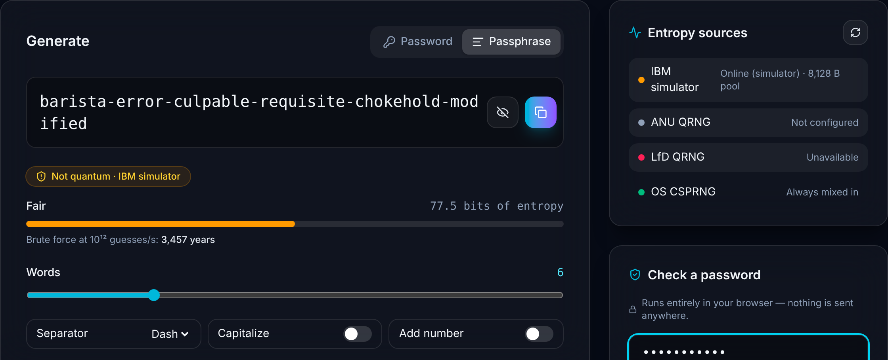
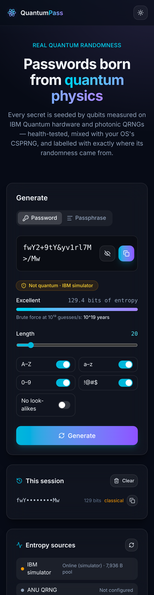
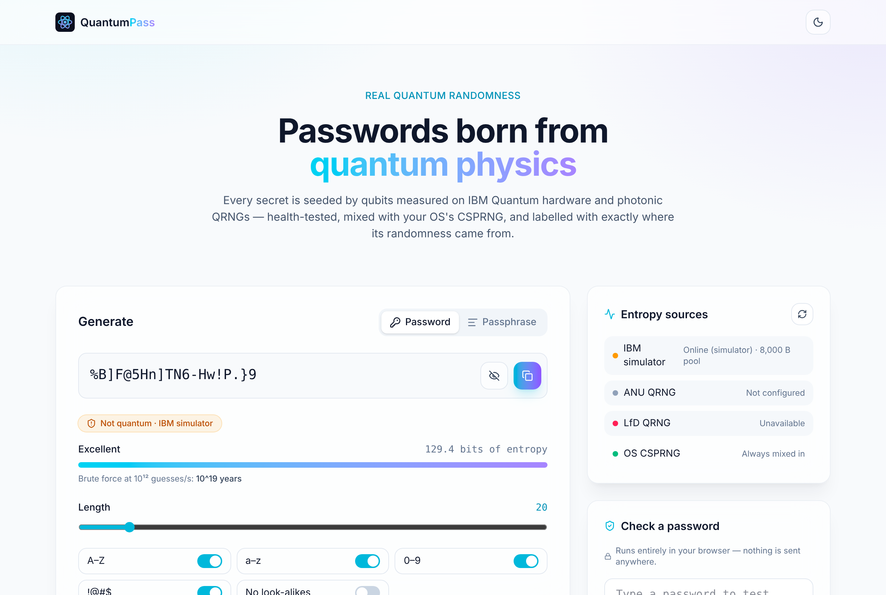
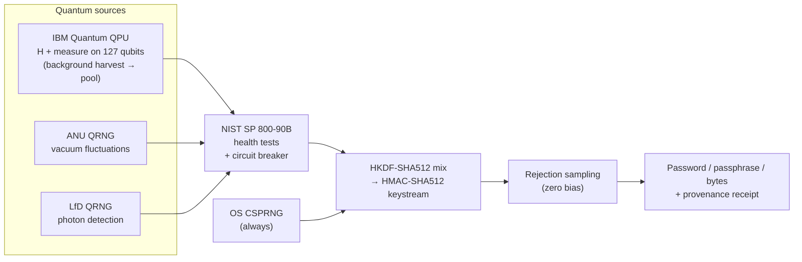

<div align="center">


# QuantumPass

### Passwords, passphrases and random numbers born from real quantum physics — with proof of where every bit came from.

[](https://github.com/ahmadhashimi/quantum-password-generator/actions/workflows/ci.yml)


</div>

---

## What it does

QuantumPass measures **real quantum systems** — qubits on IBM Quantum processors, vacuum fluctuations at the ANU, photon detection at LfD — and turns the outcomes into passwords, passphrases and raw random bytes.

Every result tells you **exactly where its randomness came from**. If no quantum source contributed (say, a provider is down), it says **"Not quantum"** instead of pretending.

| | |
|---|---|
| 🔐 **Password & passphrase generator** | Length 8–128, character sets, no look-alikes, EFF diceware passphrases |
| ⚛️ **Three quantum sources** | IBM Quantum hardware, ANU QRNG, LfD QRNG — combined, health-tested, never trusted blindly |
| 🧾 **Honest provenance** | Each result lists its sources, quantum yes/no, entropy bits and brute-force time |
| 🤖 **AI assistant** | Ask for "a password for my bank" — Claude generates it with tools, **but never sees it** |
| 🛡️ **Local strength checker** | Test an existing password with zxcvbn, entirely in your browser |
| 👤 **Accounts & analytics** | Clerk sign-in, per-user usage (metadata only — never passwords), admin dashboard with AI spend |
| 🌗 **Modern UI** | Dark/light, responsive, accessible, reduced-motion aware |

<table>
<tr>
<td width="62%"></td>
<td width="38%"></td>
</tr>
<tr>
<td align="center"><sub>Passphrase mode, live entropy sources, local strength checker</sub></td>
<td align="center"><sub>Mobile</sub></td>
</tr>
</table>



> **About these screenshots:** they were taken in a sandbox with no internet access to the quantum providers, running IBM in *simulator mode* — so the badge correctly reads **"Not quantum · IBM simulator"**. Connected to real hardware it reads **"Quantum · IBM Quantum + LfD QRNG"**.

---

## How it works



1. **Measure.** A background job puts every qubit of an IBM quantum processor into superposition and measures it 2,048 times; live requests also pull from ANU or LfD.
2. **Health-test.** NIST SP 800-90B repetition-count and adaptive-proportion tests check every raw byte. A stuck or biased source is quarantined; a circuit breaker stops hammering dead providers.
3. **Mix, never trust blindly.** The quantum seed is combined with the operating system's secure RNG through HKDF-SHA512. A tampered or broken remote source can never make output *weaker* than standard practice.
4. **Sample without bias.** Rejection sampling makes every character exactly equally likely (v1 used `byte % 79`, which made some characters ~33% more likely).
5. **Label honestly.** The response says which sources contributed and whether any of them was quantum.

---

## Who it's for

Being straight about it: **for an everyday password, a quantum source adds no measurable security over a good OS random generator** — QuantumPass mixes both precisely so it's never worse. What quantum *does* add is **provenance you can verify and audit**: proof of where randomness came from and that nobody tampered with it. That's what people pay for.

| Persona | Their problem | What QuantumPass gives them |
|---|---|---|
| 🎁 **Community / marketing manager** (giveaways, streamers, esports, NFT drops) | "The draw was rigged!" — a screenshot of a random picker proves nothing | Draws backed by quantum provenance and a public receipt |
| 🎮 **Game / web3 studio CTO** (loot, tournaments, mints) | Players want fairness proof; on-chain VRF costs gas per call | A cheap randomness API with auditable provenance |
| 🧰 **Security / dev-tool founder** | Their product looks like everyone else's | White-label "quantum-sourced" generation with real evidence behind the claim |
| 🎓 **Lecturer / research PI** | Wants students to inspect real QPU randomness without running IBM jobs | Live quantum entropy + source status for teaching |
| 🔬 **Clinical / experimental research coordinator** | Randomisation must be documented for auditors | Logged, sourced randomness *(to validate with interviews)* |
| 🙂 **Curious individual** | Wants a strong password and a cool story | Free generator + assistant |

**Not a fit yet:** regulated casinos/lotteries, banks and government — they require certifications (NIST ESV / FIPS 140-3, GLI-19, FedRAMP) this project doesn't have.

The full market, cost and pricing analysis is in **[docs/BUSINESS_PLAN.md](docs/BUSINESS_PLAN.md)**.

---

## Security & guardrails

| Area | What's in place |
|---|---|
| Secrets | Never stored, never logged (log redaction), never sent to the AI; API responses are `no-store` |
| Transport & headers | Caddy auto-HTTPS, HSTS, strict CSP, `frame-ancestors 'none'`, nosniff, no-referrer, COOP/CORP |
| Abuse | Per-IP / per-user rate limits; only the reverse proxy's `X-Forwarded-For` is trusted (no IP spoofing) |
| Auth | Clerk session JWTs verified server-side (signature, expiry, authorized party); admin role from Clerk metadata |
| AI cost | Global daily **USD kill switch**, per-user daily caps, token & tool-loop limits, prompt caching, spend on the admin dashboard |
| Quantum cost | IBM daily job cap protects the free Open Plan (10 QPU-min / 28 days) and paid instances |
| Container | Non-root, read-only filesystem, all Linux capabilities dropped |
| Supply chain | Pinned deps, pip-audit, npm audit, bandit, Dependabot in CI |

---

## Quick start

```bash
# Backend
cd backend
python -m venv .venv && source .venv/bin/activate
pip install -r requirements-dev.txt -r requirements-ibm.txt qiskit-aer
cp .env.example .env                 # every key is optional for local dev
uvicorn app.main:app --reload        # API docs at http://localhost:8000/api/docs

# Frontend (second terminal)
cd frontend
npm install
npm run dev                          # http://localhost:5173
```

With no keys at all it runs on LfD (keyless) + the OS RNG and labels results accordingly.

### Connect IBM Quantum — simulator first, then hardware

```bash
# 1. Dry run of the exact same pipeline on a local simulator (free, not quantum)
IBM_MODE=simulator python -m scripts.ibm_harvest

# 2. Real hardware: API key + Open Plan instance CRN (us-east) from quantum.cloud.ibm.com
IBM_MODE=hardware IBM_QUANTUM_TOKEN=... IBM_QUANTUM_INSTANCE=crn:v1:... \
  POOL_PATH=./entropy_pool.bin python -m scripts.ibm_harvest
```

One job (127 qubits × 2,048 shots) takes roughly 3 QPU-seconds and yields ~8 KB of conditioned quantum entropy (~127 password seeds). `IBM_MAX_JOBS_PER_DAY` (default 2) keeps you inside the free plan.

### Clerk (sign-in + user tracking)

1. Set `VITE_CLERK_PUBLISHABLE_KEY` (frontend) and `CLERK_SECRET_KEY` (backend).
2. **Sessions → Customize session token:** `{"email": "{{user.primary_email_address}}", "name": "{{user.full_name}}", "metadata": "{{user.public_metadata}}"}`
3. Make yourself admin with public metadata `{"role": "admin"}`.
4. Optional: webhook `https://<host>/api/v2/webhooks/clerk` for `user.*` events + `CLERK_WEBHOOK_SECRET`.

---

## API

| Endpoint | Returns |
|---|---|
| `GET /api/v2/password?length=20&upper&lower&digits&symbols&exclude_ambiguous` | Password, entropy bits, provenance |
| `GET /api/v2/passphrase?words=6&separator=-&capitalize&add_number` | Diceware passphrase |
| `GET /api/v2/random?bytes=32` | Random bytes (hex) |
| `GET /api/v2/entropy/status` | Live state of every source, health tests, IBM pool |
| `POST /api/v2/assistant/chat` | Server-sent events: `text`, `tool`, `secret`, `error`, `done` |
| `GET /api/v2/me` · `GET /api/v2/admin/stats` | Your usage · admin dashboard |

Example response:

```json
{
  "password": "k#9Vq…",
  "length": 20,
  "entropy_bits": 129.4,
  "provenance": {
    "sources": ["ibm_quantum", "lfd"],
    "quantum": true,
    "quantum_bytes": 128,
    "mixed_with": "os_csprng",
    "failures": {}
  }
}
```

---

## Testing

```bash
cd backend && pytest            # 70 tests: entropy, health tests, providers, IBM simulator, auth, webhooks, assistant, guardrails
pytest -m live                  # real ANU/LfD calls (needs network / ANU_API_KEY)
python -m scripts.entropy_audit # monobit, runs, chi-square, min-entropy per live source
cd frontend && npm test         # 7 tests
```

## Deploy

```bash
cp backend/.env.example backend/.env
DOMAIN=quantumpass.example.com VITE_CLERK_PUBLISHABLE_KEY=pk_live_... docker compose up -d --build
```

Caddy terminates TLS in front of a single app instance (rate limits, the entropy pool and chat history live in memory — move them to Redis/Postgres before scaling out).

## Project structure

```
backend/app/entropy/     quantum providers, health tests, pool, mixer, service
backend/app/generator.py rejection sampling, passwords, passphrases
backend/app/assistant/   Claude agent + tools (secrets never reach the model)
backend/app/auth.py      Clerk verification       backend/app/db.py  users + usage
frontend/src/            React 19 + Vite + Tailwind v4
deploy/Caddyfile         reverse proxy            docs/              business plan, screenshots
```

---

<div align="center">

Built by **Mujtaba Hashimi** · Diceware wordlist © EFF (CC BY 3.0 US), lightly filtered

</div>
