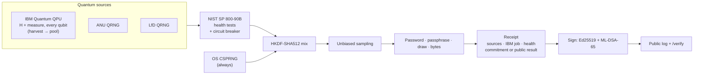

<div align="center">


# QuantumPass

### Randomness you can prove.

Passwords, passphrases and giveaway draws generated by qubits on real quantum computers — each with a **post-quantum signed receipt** that shows exactly where its randomness came from.

[](https://github.com/ahmadhashimi/quantum-password-generator/actions/workflows/ci.yml)


-8B5CF6)


[**Run a draw**](#-quick-start) · [**How it works**](#-how-it-works) · [**Verify a receipt**](#-verify-anything-offline) · [**Who it's for**](#-who-its-for)


</div>

---

## 📖 The story

> **Meet Maya** — community lead at an indie game studio with 40,000 Discord members.
>
> Maya runs a launch giveaway: 3 rare skins, 12,000 entries. An hour after the winners are announced, the replies fill with *"rigged"*, *"the dev's friend won"*, *"show proof"*. A screenshot of a random-picker website proves nothing. Neither does "we used a secure RNG".
>
> With QuantumPass, Maya pastes the entry list and qubits on an IBM quantum computer pick the winners. Maya posts **one link**. Anyone can open it and see the winners, a fingerprint of the exact entry list, and the quantum hardware job that produced the randomness — all sealed with a signature built to survive even future quantum computers.
>
> The thread goes quiet.

## ❗ The problem

**Randomness is invisible.** Giveaway winners, loot drops, tournament seeds, keys and passwords are produced by systems nobody can audit — and people are simply asked to trust them.

- Every "random picker" result is just a claim. Disputes cost creators and studios their reputation.
- Weak or misused random generators have caused real losses — e.g. the ~$160M Wintermute hack (vanity-address keys) and the 2023 "Milk Sad" wallet drain (time-seeded RNG).
- "Quantum" products usually ask for even *more* trust: a label, with no evidence behind it.

## 💡 The solution

**QuantumPass makes randomness auditable.**

1. **Real quantum entropy** — qubits measured on IBM Quantum processors, plus the ANU (vacuum fluctuations) and LfD (photonic) quantum random number generators.
2. **Never weaker than standard practice** — quantum bytes are health-tested and mixed with the operating system's secure RNG, so a broken or tampered source can't hurt you.
3. **A receipt for every result** — signed with **Ed25519 + ML-DSA-65** (NIST's post-quantum signature standard). It records the sources, the IBM job, the health-test result, and either the public result (draws) or only a *fingerprint* of your secret (passwords).
4. **Anyone can verify** — on a public page, or offline with a 50-line script. Change a single byte and verification fails.

<table>
<tr>
<td width="50%"></td>
<td width="50%"></td>
</tr>
<tr>
<td align="center"><sub><b>Provably fair draw</b> — winners + post-quantum signed receipt + share link</sub></td>
<td align="center"><sub><b>Public verification</b> — both signatures, sources, IBM job, winners</sub></td>
</tr>
</table>

## 🚀 What's new (the innovation)

| | Typical generator | Random picker sites | **QuantumPass** |
|---|:---:|:---:|---|
| Strong randomness | ✓ | varies | ✓ never weaker than your OS RNG |
| Real quantum source | — | — | ✓ IBM Quantum, ANU, LfD |
| Shows where randomness came from | — | — | ✓ per result |
| Public, tamper-evident proof | — | screenshot | ✓ signed receipt + verify page |
| Signature built for the quantum era | — | — | ✓ hybrid Ed25519 + ML-DSA (FIPS 204) |
| Proof without revealing secrets | — | n/a | ✓ SHA-512 commitment, private salt |
| AI assistant that never sees your password | — | — | ✓ |

**Honest note:** for an everyday password, quantum randomness doesn't make it *stronger* than a good OS random generator — the value is **provenance you can prove**. We never claim "unhackable".

## 👥 Who it's for

| Persona | Pain | What they get | Would pay |
|---|---|---|---|
| 🎁 **Community / marketing manager** (giveaways, streamers, esports, NFT drops) | "It was rigged!" | Draws with a public, signed receipt | $19–99/mo |
| 🎮 **Game / web3 studio CTO** | Players want fairness proof; on-chain VRF costs gas per draw | Auditable randomness API | $50–500/mo |
| 🧰 **Security / dev-tool founder** | Product looks like everyone else's | "Quantum-sourced" generation with real evidence | $49–499/mo |
| 🎓 **Lecturer / research PI** | Students can't easily inspect real QPU randomness | Live quantum entropy + receipts for teaching | $0–50/mo |
| 🙂 **Security-minded individual** | Wants a strong password and a story | Free generator, signed receipts, assistant | Free / $5 Pro |

*Price ranges are research estimates, not validated with customers. Full analysis: [docs/BUSINESS_PLAN.md](docs/BUSINESS_PLAN.md).*

---

## ⚙️ How it works




### Receipt format

```json
{
  "payload": {
    "version": "qpg-receipt/1",
    "receipt_id": "vU6SU2rcqT2ThHgW",
    "kind": "draw",
    "key_id": "ae553ddae018275e",
    "provenance": {
      "sources": ["ibm_quantum", "lfd"], "quantum": true, "quantum_bytes": 128,
      "ibm_job": { "backend": "ibm_brisbane", "job_id": "d0…", "mode": "hardware" },
      "health": { "sp800_90b": "pass" }
    },
    "commitment": null,
    "result": { "title": "Launch giveaway", "entries_count": 12000,
                "entries_sha256": "9f2c…", "winners": [{ "index": 4711, "entry": "@player4712" }] }
  },
  "signatures": { "ed25519": "…", "ml-dsa-65": "…" }
}
```

A receipt is valid only if **both** signatures verify, so it stays trustworthy unless both schemes are broken. For passwords, `commitment = SHA-512(salt ‖ password)`; only you get the salt.

## 🔍 Verify anything offline

```bash
curl -s https://<host>/.well-known/quantumpass-keys.json > keys.json
python -m scripts.verify_receipt receipt.json keys.json --entries entries.json
# Ed25519: ok   ML-DSA-65: ok
# Entries list matches: True
# VALID
```

Edit any field (e.g. flip `"quantum": false` to `true`) and the result is **INVALID**.

---

## 🛡️ Security & guardrails

| Area | What's in place |
|---|---|
| Sign-in | Clerk with **passkeys** (phishing-resistant), MFA, server-side JWT verification |
| Secrets | Never stored, logged, or sent to the AI; receipts hold only commitments; API responses `no-store` |
| Signatures | Hybrid Ed25519 + ML-DSA-65; keys in a 0600 file or secret env var; public keys at `/.well-known/` |
| Transport | Caddy auto-HTTPS, HSTS, strict CSP, `frame-ancestors 'none'` |
| Abuse | Per-IP / per-user rate limits; only the proxy's `X-Forwarded-For` is trusted |
| AI cost | Per-user daily $ cap, global daily + monthly $ kill switches, token & tool-loop limits, prompt caching |
| Quantum cost | IBM daily job cap protects the free plan (10 QPU-min / 28 days) |
| Container | Non-root, read-only filesystem, all capabilities dropped |
| Supply chain | Pinned deps, pip-audit, npm audit, bandit, Dependabot |

<details>
<summary><b>Recommended Clerk settings for professional auth</b></summary>

1. **User & authentication → Passkeys:** enable (and allow sign-in with passkey).
2. **Multi-factor:** enable authenticator apps + backup codes; require MFA for admins.
3. **Attack protection:** enable bot protection, disposable-email blocking and brute-force lockout.
4. **Sessions → Customize session token:** `{"email": "{{user.primary_email_address}}", "name": "{{user.full_name}}", "metadata": "{{user.public_metadata}}"}`
5. Set your user's public metadata to `{"role": "admin"}` for the admin dashboard.
6. Webhook `https://<host>/api/v2/webhooks/clerk` (user.* events) + `CLERK_WEBHOOK_SECRET`.

</details>

---

## 🏁 Quick start

```bash
# Backend
cd backend
python -m venv .venv && source .venv/bin/activate
pip install -r requirements-dev.txt -r requirements-ibm.txt qiskit-aer
cp .env.example .env
uvicorn app.main:app --reload        # API docs: http://localhost:8000/api/docs

# Frontend
cd frontend && npm install && npm run dev   # http://localhost:5173
```

**Connect IBM Quantum — simulator first, then hardware:**

```bash
IBM_MODE=simulator python -m scripts.ibm_harvest                     # free dry run (labelled "not quantum")
IBM_MODE=hardware IBM_QUANTUM_TOKEN=... IBM_QUANTUM_INSTANCE=crn:v1:... \
  POOL_PATH=./entropy_pool.bin python -m scripts.ibm_harvest          # real QPU
```

**Deploy:** `DOMAIN=quantumpass.example.com docker compose up -d --build` (Caddy + app).

## 📡 API

| Endpoint | Description |
|---|---|
| `POST /api/v2/draw` | Provably fair draw → winners + signed receipt |
| `GET /api/v2/password?…&receipt=true` | Password (+ receipt + private salt) |
| `GET /api/v2/passphrase?…&receipt=true` | Diceware passphrase (+ receipt) |
| `GET /api/v2/random?bytes=32&receipt=true` | Random bytes (+ receipt) |
| `POST /api/v2/receipts/verify` | Verify signatures, commitment, entries list |
| `GET /api/v2/receipts/{id}` · `GET /.well-known/quantumpass-keys.json` | Public log · public keys |
| `GET /api/v2/entropy/status` | Live source health, IBM pool |
| `POST /api/v2/assistant/chat` | AI assistant (SSE) |

## 🧪 Testing

```bash
cd backend && pytest       # 81 tests: entropy, health tests, IBM simulator, receipts & tamper detection, draws, auth, guardrails
cd frontend && npm test    # 7 tests
```

> The screenshots were taken in a sandbox without access to the quantum providers, running IBM in **simulator mode** — so badges honestly read *"Not quantum · IBM simulator"*. On real hardware they read *"Quantum · IBM Quantum + LfD QRNG"*.

## 🗺️ Roadmap

- [x] Real quantum entropy (IBM, ANU, LfD) with health tests and honest labels
- [x] Post-quantum signed receipts + public verification + offline verifier
- [x] Provably fair draws
- [ ] Stripe plans (Free / Pro / Team / API) with automatic limits
- [ ] Developer API keys and branded verify pages
- [ ] Quantum-evidence receipts (physics checks bound to the IBM job) — *in research*

## 👉 Try it

**Run your first provably fair draw** → start the app and open `/#/draw`, or [open an issue](https://github.com/ahmadhashimi/quantum-password-generator/issues) to get early access to the hosted version.

---

<div align="center">

Built by **Mujtaba Hashimi** · Diceware wordlist © EFF (CC BY 3.0 US), lightly filtered

</div>
